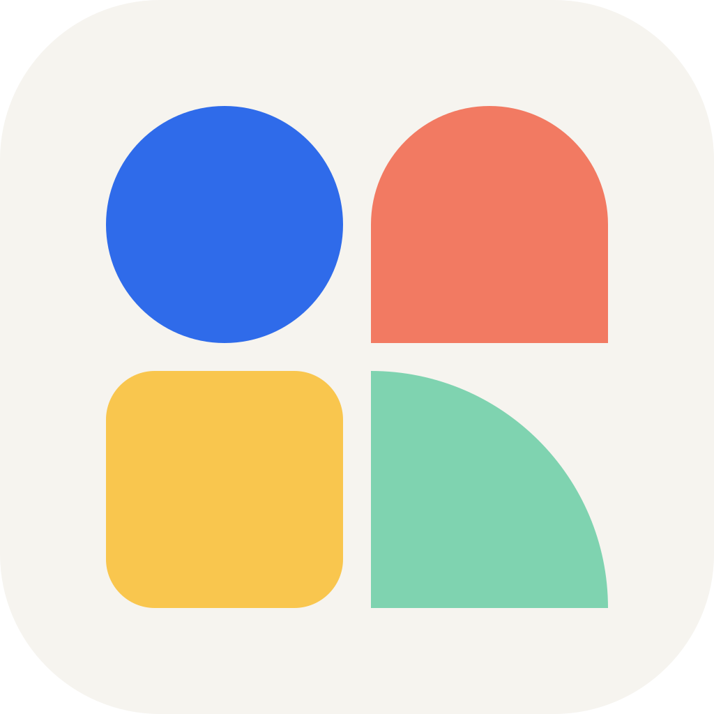
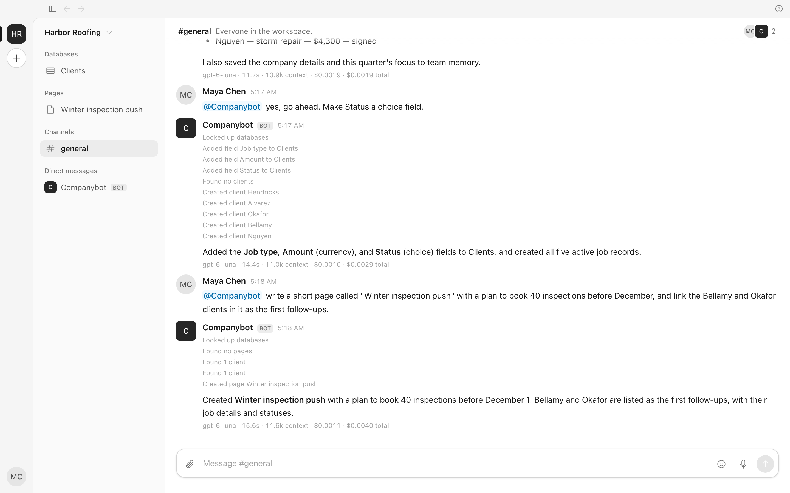
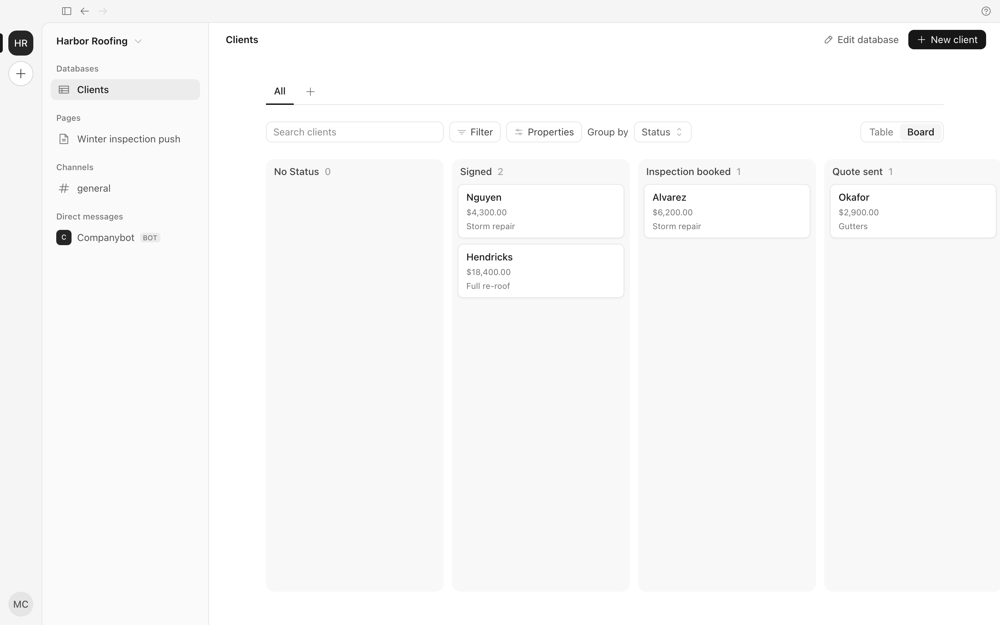
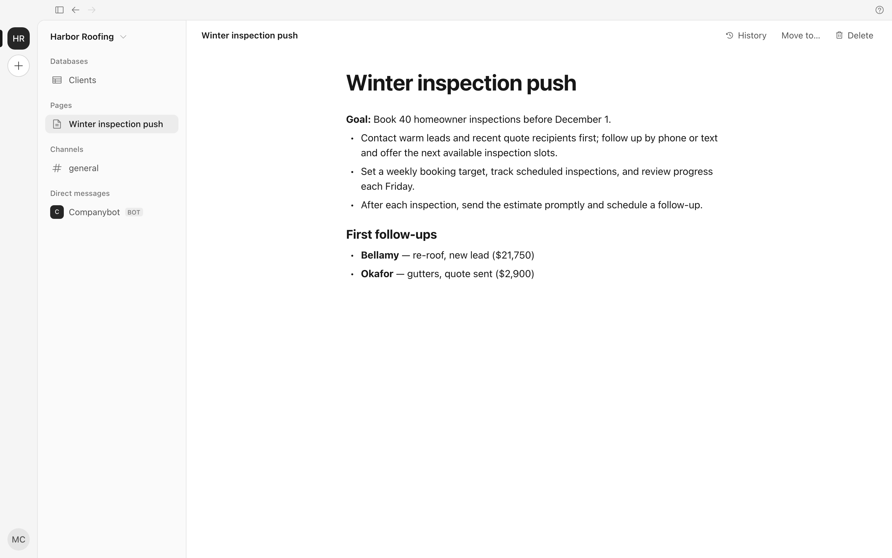

<p align="center">
  
</p>

<h1 align="center">Companybot</h1>

<p align="center">
  <strong>CRM, team chat and AI agents for your company, in one place.</strong><br>
  Ask an agent in chat and it updates your records, writes pages and keeps work moving.
</p>

<p align="center">
  <a href="https://github.com/oobagi/companybot/releases"></a>
  <a href="https://github.com/oobagi/companybot/actions/workflows/ci.yml"></a>
  <a href="LICENSE"></a>
  
</p>

<p align="center">
  <a href="https://github.com/oobagi/companybot/releases"><b>Download</b></a> ·
  <a href="wiki/product.md">Product</a> ·
  <a href="wiki/architecture.md">Architecture</a> ·
  <a href="CONTRIBUTING.md">Contributing</a>
</p>

<p align="center">
  
</p>

> [!NOTE]
> Companybot is in **alpha**. We use it to run our own team, and it changes fast. Expect rough edges.

## What it does

An agency's worth of work (finding leads, following up, running the pipeline) done by agents, for businesses that could never afford an agency. One AI sees the whole loop, and **the data lives in Companybot**, not behind a connector.

- **Team chat.** Channels, DMs, threads and reactions. @mention an agent in any channel, or DM it for anything private.
- **Databases you shape.** Clients, deals, jobs, anything you need: custom fields, links between records, table and board views, filters, saved views, full history with undo, and a 30-day Trash.
- **Pages.** Notion-style docs, standalone or as the body of any record, with version history.
- **Agents that do the work.** Companybot (the main agent) and any agents you add can find, create and change records, add fields, write pages and remember things for the team, acting only as the person who asked.
- **You stay in control.** Risky actions ask first (Allow once, Always or Deny). Owners can lock rules, and every change shows who did it, including "Companybot, for Maya".
- **Connectors, skills and automations.** Bring outside data in, teach agents how your team works, and run agents on a schedule.

<table>
  <tr>
    <td width="50%"></td>
    <td width="50%"></td>
  </tr>
  <tr>
    <td align="center"><sub>Any database as a board, grouped by any field</sub></td>
    <td align="center"><sub>Pages written by people and agents</sub></td>
  </tr>
</table>

<sub>Screenshots are the real app with a demo workspace. Every record and page in them was made by Companybot from the chat messages shown.</sub>

## Get it

**macOS:** download the latest `.dmg` from [Releases](https://github.com/oobagi/companybot/releases). The app updates itself.

Windows and Linux builds aren't available yet.

## Run from source

Needs Node 22+ and pnpm (`corepack enable`).

```sh
pnpm install
pnpm dev        # a local Convex backend for this checkout, plus the desktop app
```

Sign in with any email. Local backends skip the email code. `pnpm dev --reset` wipes your local data.

No Convex account needed: outside the team, `pnpm dev` runs an anonymous local backend. For agent replies, export an [AI Gateway](https://vercel.com/ai-gateway) key first: `export AI_GATEWAY_API_KEY=…`.

```sh
pnpm test && pnpm typecheck
pnpm --filter @companybot/desktop preview:web   # the UI in a browser at localhost:5173
```

Server secrets (AI Gateway key, sign-in email, encryption key) are listed in [`.env.example`](.env.example). More in [Architecture → Run](wiki/architecture.md#run).

## How it's built

| Part | What |
|---|---|
| [`src/desktop`](src/desktop) | Electron + React app (Tailwind, BlockNote, Phosphor icons) |
| [`src/backend`](src/backend) | [Convex](https://convex.dev) backend: data, auth, agents, tools |
| [`src/core`](src/core) | Shared types and logic |
| [`wiki/`](wiki/index.md) | How everything works and why. Start at the [index](wiki/index.md). |

Models run through the Vercel AI Gateway, so agents can use any provider.

## Contributing

Issues and PRs are welcome. Read [CONTRIBUTING.md](CONTRIBUTING.md) first. Outside contributors sign the [CLA](CLA.md) once, by commenting on their first PR.

Found a security issue? Please follow [SECURITY.md](SECURITY.md) instead of opening an issue.

## License

[AGPL-3.0](LICENSE). Anyone can self-host. If you run a changed version as a service, you must publish your changes. A paid Cloud edition and an Enterprise license are planned; see [Product → Open source](wiki/product.md#open-source).
